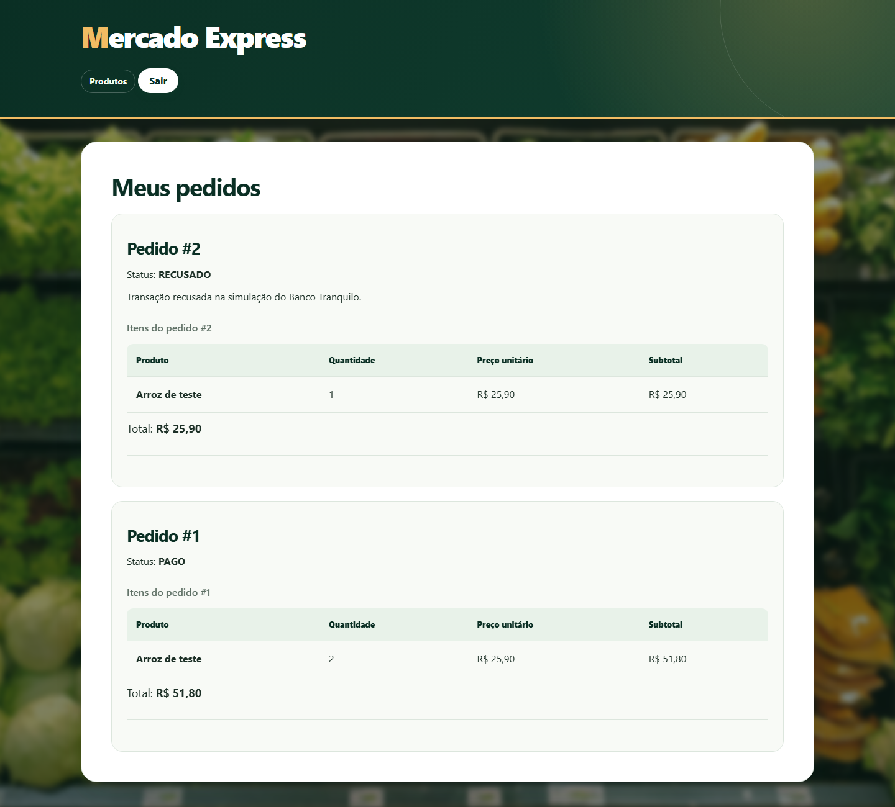
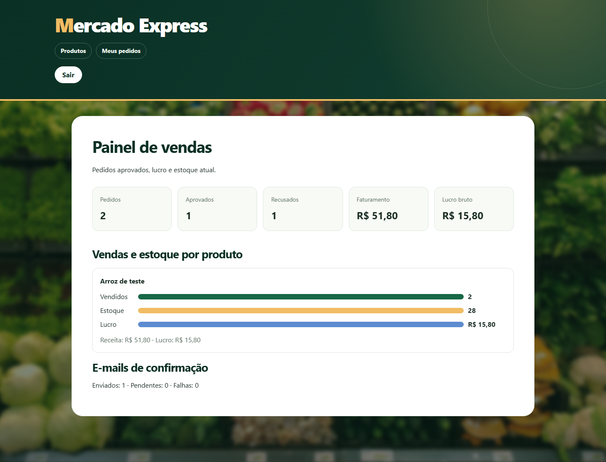

# Mercado Express — CP5, Parte 2

Aplicação Spring Boot separada da [Parte 1](https://github.com/EnzoMMaciel10/cp5-parte1). Esta parte processa compras usando RabbitMQ, uma API **simulada** do Banco Tranquilo criada pelo grupo, e e-mail de confirmação. Também inclui um painel administrativo com vendas, lucro e estoque.

## Arquitetura

```text
Cliente/Postman → Mercado Express (porta 8080) → PostgreSQL
                         │
                         ▼
                 RabbitMQ: requisições
                         │
                         ▼
                 Banco Tranquilo API (porta 8081)
                         │
                         ▼
                 RabbitMQ: respostas
                         │
                         ▼
                 Pedido PAGO/RECUSADO + estoque + registro de e-mail
                                               │
                                               ▼
                                         SMTP / Mailpit
```

O serviço do banco fica em [`banco-tranquilo-api`](banco-tranquilo-api). A API recebe a referência, o valor e `simularRecusa`; responde `APROVADO` ou `RECUSADO` com um protocolo. **É uma simulação acadêmica: não efetua cobrança real.** O protocolo é estável para a mesma referência, facilitando a repetição de mensagens. Mensagens com erro vão para `mercado.pagamentos.erros.q`. A resposta duplicada não altera estoque nem cria outro e-mail.

## Tecnologias

Java 17, Spring Boot 4.0.8, Spring MVC, Spring Security, Thymeleaf, Spring Data JPA, PostgreSQL, Spring AMQP/RabbitMQ, Spring Mail e Maven.

## Telas da aplicação


A página inicial dá acesso ao catálogo e ao cadastro de clientes.



A tela de pedidos mostra os dois resultados da API simulada. Só a compra aprovada baixou o estoque e gerou e-mail.



O painel mostra os totais e gráficos por produto. No exemplo, o pedido aprovado faturou R$ 51,80 e gerou R$ 15,80 de lucro bruto.

## Como executar localmente

1. Abra o Docker Desktop e, na pasta deste repositório, execute `docker compose up -d`. Isso inicia PostgreSQL em `localhost:5433`, RabbitMQ em `localhost:5672` (painel em `http://localhost:15672`, usuário e senha `guest`) e Mailpit em `http://localhost:8025` (SMTP na porta 1025).
2. Use Java 17. Em um terminal PowerShell, configure as variáveis abaixo e inicie o Mercado Express:

   ```powershell
   $env:DB_URL = 'jdbc:postgresql://localhost:5433/cp5'
   $env:DB_USERNAME = 'postgres'
   $env:DB_PASSWORD = 'cp5-local'
   $env:MAIL_HOST = 'localhost'
   $env:MAIL_PORT = '1025'
   $env:MAIL_FROM = 'mercado@localhost'
   $env:BANK_API_KEY = 'demo-local'
   .\mvnw.cmd spring-boot:run
   ```

   No IntelliJ IDEA, selecione o JDK 17 e execute `Cp5Application`. Com o `docker compose` ativo, o acesso ao PostgreSQL local já funciona sem configurar variáveis no IntelliJ. Para ver os e-mails no Mailpit, defina `MAIL_HOST=localhost` na configuração de execução.

3. Em outro terminal, inicie o banco simulado:

   ```powershell
   $env:BANK_API_KEY = 'demo-local'
   .\mvnw.cmd -f banco-tranquilo-api\pom.xml spring-boot:run
   ```

4. Acesse `http://localhost:8080` e crie uma conta. A conta criada pela tela é cliente. Para ter um administrador local, depois do cadastro troque `seu@email.com` pelo e-mail cadastrado e execute:

   ```powershell
   docker compose exec postgres psql -U postgres -d cp5 -c "UPDATE tds_users_mercado SET perfil='ADMIN' WHERE email='seu@email.com';"
   ```

   Saia e entre novamente na aplicação. Cadastre um produto, faça um pedido e acompanhe o resultado em **Meus pedidos**. O administrador pode abrir **Painel de vendas**.

O `application.yaml` aceita `DB_URL`, `DB_USERNAME`, `DB_PASSWORD`, `RABBITMQ_URL`, `BANK_BASE_URL`, `BANK_API_KEY`, `MAIL_HOST`, `MAIL_PORT`, `MAIL_USERNAME`, `MAIL_PASSWORD`, `MAIL_AUTH`, `MAIL_STARTTLS` e `MAIL_FROM`. Em hospedagem, configure chaves e senhas nas variáveis privadas do serviço; não as publique no GitHub.

## Exemplos JSON para Postman/Insomnia

O endpoint de compra exige autenticação HTTP Basic com e-mail e senha de uma conta cadastrada. A resposta inicial `202 Accepted` informa que o pedido foi enfileirado; o resultado final é assíncrono e aparece em `/pedidos`.

`POST http://localhost:8080/api/compras`

```json
{
  "produtoId": 1,
  "quantidade": 2,
  "simularRecusa": false
}
```

Para demonstrar recusa, envie o mesmo JSON com `"simularRecusa": true`. O produto precisa existir e ter estoque suficiente. Exemplo de resposta inicial:

```json
{
  "pedidoId": 1,
  "status": "ENFILEIRADO",
  "mensagem": "Consulte o status em /pedidos."
}
```

Depois, consulte `GET http://localhost:8080/api/compras/1` com a mesma autenticação Basic. A resposta inclui `status` (`AGUARDANDO_PAGAMENTO`, `PAGO` ou `RECUSADO`), `total`, `protocoloBanco`, `motivoRecusa` e `statusEmail`.

A API criada para representar o Banco Tranquilo pode ser testada separadamente com o cabeçalho `X-Banco-Api-Key: demo-local`:

`POST http://localhost:8081/api/banco-tranquilo/transacoes`

```json
{
  "referencia": "pedido-demo-1",
  "valor": 51.80,
  "simularRecusa": false
}
```

Exemplo de resposta (o protocolo concreto depende da referência):

```json
{
  "referencia": "pedido-demo-1",
  "status": "APROVADO",
  "protocolo": "uuid-gerado-pelo-banco",
  "motivo": null
}
```

## Regras e acompanhamento

- O pedido começa em `AGUARDANDO_PAGAMENTO`. Uma resposta aprovada marca `PAGO`, baixa o estoque e cria um registro de e-mail. Uma resposta recusada marca `RECUSADO` e preserva o estoque.
- Se o RabbitMQ estiver fora do ar, o pedido continua salvo. Em **Meus pedidos** é possível reenviar a solicitação de pagamento.
- O envio de e-mail é registrado no PostgreSQL em `tds_emails_pedido_mercado` como `PENDENTE`, `ENVIADO` ou `FALHA`. Com o Mailpit ligado, o e-mail aprovado aparece em `http://localhost:8025`. Sem SMTP configurado, fica pendente.
- O painel `/painel` é exclusivo do administrador e soma somente pedidos pagos para faturamento, lucro e produtos vendidos. O estoque mostra a posição atual dos produtos.

## Banco e demonstração

Para o professor reproduzir localmente, o `compose.yaml` contém a configuração completa do banco de demonstração (`cp5` em `localhost:5433`). Em uma hospedagem pública, as credenciais de produção devem ser fornecidas por canal privado, nunca no README. As tabelas são criadas pelo Hibernate na primeira execução.

Para o vídeo de 5 a 7 minutos, mostre os dois projetos Java, as filas no painel RabbitMQ, uma compra aprovada e outra recusada via tela ou Postman, o e-mail no Mailpit, as tabelas PostgreSQL e o painel de vendas. A entrega também pede o projeto compactado, o link do GitHub e os nomes/RMs.

## Testes

Execute `.\mvnw.cmd test` na raiz e `.\mvnw.cmd -f banco-tranquilo-api\pom.xml test` para verificar os dois serviços. Para o teste completo com infraestrutura, suba o `compose.yaml` e faça uma compra aprovada e outra recusada.

## Integrantes

- Enzo Monteiro Maciel - RM563734
- Matheus de Almeida Sousa - RM563557
- Paulo Estalise - RM563811
- Gabriel Bebé Silva - RM562012
- Emanuel Italo - RM561337

IDE: IntelliJ IDEA.
